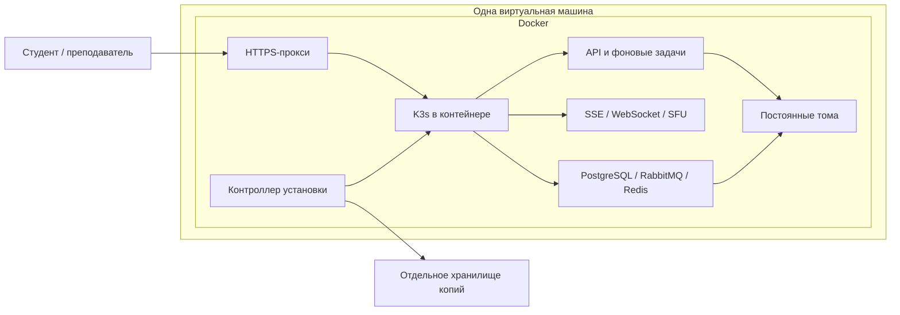

# Одна ВМ: Docker → K3s → приложение

Основной вариант для учреждения, которому выделяют одну Linux-ВМ с Docker Engine и Compose.
Docker запускает K3s, контроллер установки и внешний HTTPS-прокси. В Kubernetes работают API,
SSE/WebSocket, фоновые задачи, конвертер, аналитика, SFU, две PostgreSQL, RabbitMQ и Redis.
Нативный K3s в `deploy/k8s` остаётся вариантом для нескольких физических серверов.

Это одна точка отказа: Kubernetes перезапускает процессы, но не спасает от потери ВМ/диска.
Для этой аварии нужны резервные копии на отдельном хранилище и восстановление на новой ВМ.
10 000 одновременных видеозрителей на одной ВМ этим пакетом не обещаются.



## Что подготовить

- Linux-ВМ: начальный ориентир 8 vCPU, 16 ГБ RAM, 120 ГБ SSD. Это исходная конфигурация
  для пилота, а не подтверждённая ёмкость; объём видео, материалов и одновременные занятия
  проверяют нагрузочным испытанием конкретной установки.
- Docker Engine с Compose v2. Доступ root/привилегированный контейнер нужен K3s;
  API и браузеру Docker socket не выдаётся. Kubernetes API и базы наружу не публикуются.
- Домен с HTTPS: либо университетский обратный прокси на loopback-порт 18094,
  либо собственные сертификаты Caddy (`tlsMode: automatic`, HTTP/HTTPS 80/443).
- Для видео доступный IPv4 ВМ, TCP 7881 и UDP 7882, NAT с сохранением этих портов.
  При заблокированном UDP используется TCP. TURN/TLS для сетей, блокирующих оба порта,
  пока настраивается отдельно; без этого работу видео в таких сетях обещать нельзя.
- Свой MAX-бот и его токен, URL мини-приложения на этот домен. Один бот — одна установка.
- Проверенные образы релиза `images.json` с SHA256, опубликованный образ контроллера,
  при включении обновлений — подписанный HTTPS-каталог и доверенный открытый ключ.
- Каталог резервных копий на отдельном диске/NFS. Он содержит секреты: доступ только
  администратору, шифрование/копирование вне ВМ на стороне учреждения.

## Установка

Выполнять из проверенного checkout/архива релиза. Никаких сборок Java/Node на ВМ не требуется.
Для разработки контроллер можно собрать командой `sh deploy/appliance/lecturer.sh build-controller`.
Для учреждения укажите опубликованный `CONTROLLER_IMAGE` из релиза.

```sh
export CONTROLLER_IMAGE=ghcr.io/ORGANIZATION/lecturer-controller@sha256:RELEASE_DIGEST
export APPLIANCE_STATE=/srv/lecturer/config
export APPLIANCE_BACKUPS=/mnt/backup/lecturer
# Скопировать site.example.json, заменить домен, IP, имя бота и параметры масштабирования.
sh deploy/appliance/lecturer.sh init site.json images.json
sh deploy/appliance/lecturer.sh up
sh deploy/appliance/lecturer.sh logs
sh deploy/appliance/lecturer.sh status
```

Токен MAX можно заранее поместить файлом `max-token` с правами 600 в `APPLIANCE_STATE`:
инициализация перенесёт его в закрытые настройки и удалит промежуточный файл.
Не используйте для испытаний токен действующего стенда.

Для собственного HTTPS дополнительно **до up**:

```sh
export HTTP_BIND=0.0.0.0 HTTP_PORT=80 HTTPS_BIND=0.0.0.0 HTTPS_PORT=443
```

В `site.json` выбрать `tlsMode: automatic`; DNS должен указывать на ВМ.
В режиме университетского прокси оставить `tlsMode: proxy` и loopback-привязку.
Запросы SSE/WebSocket проксировать без буферизации и с подходящими idle timeout.

Получить одноразовый установочный ключ: `sh deploy/appliance/lecturer.sh admin`.
Создать администратора через штатную первоначальную настройку. Ключ не пересылать студентам.
После создания администратора повторное создание через bootstrap API запрещается сервером.

`up` запускает контейнеры; первая подготовка Kubernetes продолжается в контроллере.
Готовность приложения видна по `Installation ready` и `status`, не по одному статусу Docker.

## Масштабирование и границы

HPA масштабирует API и конвертер по CPU. KEDA масштабирует шлюзы по числу SSE/WebSocket
соединений и обработчики по очередям в PostgreSQL. Минимум — одна копия, максимум задаётся
в `scaling`. Бюджет БД учитывает все копии и запас на обновление; опасная конфигурация отклоняется.
Потеря метрик переводит обработчики к ограниченному максимуму, а не выключает их.

По умолчанию верхние пределы: API 2, шлюзы 3, обработчики/конвертер/аналитика по 2.
Сам K3s ограничен Docker `CLUSTER_MEMORY=12g`, `CLUSTER_CPUS=8`; добавление реплик **не добавляет
ресурсов ВМ**. При постоянном дефиците увеличивают ВМ и эти лимиты, затем бюджеты/максимумы.
PostgreSQL, RabbitMQ, Redis и SFU в этой установке не масштабируются горизонтально.
Для нескольких ВМ нужен отдельный кластер, внешнее/реплицируемое хранилище и другая схема данных.
Не разносить текущие local-path PVC по серверам вручную.

## Обновления из интерфейса

В `site.json` указать:

```json
"updates": {
  "catalogUrl": "https://releases.example.edu/lecturer/catalog.json",
  "publicKey": "-----BEGIN PUBLIC KEY-----\n...\n-----END PUBLIC KEY-----\n"
}
```

Администратор открывает «Ещё → Обновления», выбирает релиз и запускает обновление.
Оператор сам получает подписанный каталог, проверяет совместимость, ждёт завершения всех
активных/запланированных занятий, закрывает запуск новых, делает проверенную копию БД+файлов,
меняет образы и проверяет готовность **реальных подов**, включая замену SFU с OnDelete.
По одному тегу `latest` ничего не обновляется. Веб-образ общий для учреждений: имя MAX-бота
подаётся во время установки через публичный конфиг.

Поддерживаются совместимые обновления приложения. ОС ВМ, Docker, K3s/KEDA, схема развёртывания
и увеличение диска обслуживаются отдельно, вне кнопки обновления приложения.
Автоустановка без решения администратора не включена. Для несовместимой миграции нужен
отдельный регламент. При неизвестном результате оператор останавливается с «Нужна проверка»;
повторно вслепую миграции не запускаются, база автоматически назад не откатывается.

## Резервная копия и восстановление

```sh
sh deploy/appliance/lecturer.sh backup
```

Копия содержит обе БД, фактически подключённый PVC файлов, конфигурацию, ключи и версии образов.
Блокировка файлов удерживается на протяжении дампа основной БД и чтения файлов; при потере
блокировки копия отвергается. Проверяются форматы дампов, архив и контрольные суммы.
Копии не удаляются автоматически. Ротацию и регулярный запуск назначает администратор ВМ.

Восстанавливать только в **новый** Docker-проект/новую ВМ, с отдельным состоянием и пустыми БД:
инициализировать установку, подключить каталог копий, выполнить `restore ИМЯ_КОПИИ`, затем `up`.
Команда откажется перезаписывать уже установленную систему. Это аварийное восстановление,
а не кнопка отмены обновления. Периодически проверять восстановление на отдельной площадке.

`stop` останавливает три контейнера без удаления томов; `up` возобновляет установку.
Не выполнять `docker compose down -v`: это удаляет данные K3s и приложения.

## Выпуск версий для сопровождающих

`Publish installation release` запускается вручную на проверенном коммите и сначала выполняет
полный CI. Образы публикуются в GHCR для amd64/arm64, метаданные используют только digest.
Защищённое GitHub environment `installation-release` должно содержать `RELEASE_SIGNING_KEY`
(Ed25519 PEM) и обязательное подтверждение сопровождающего. Приватный ключ в пакет не входит.
Workflow создаёт **предварительный** релиз: архив установки, образы, открытый ключ и подписанный
каталог. Сам запуск workflow не обновляет установки учреждений.

`catalog.json` надо опубликовать без изменений по настроенному постоянному HTTPS-адресу
учреждения/сопровождающей организации. Прямой GitHub Release download URL для оператора
не подходит: там редиректы, а оператор их запрещает. Для GitLab/вузовского CI можно использовать
тот же `release.py` и `publish-catalog.py`, затем выложить JSON на свой HTTPS-сервер.
Каталог действует до 30 дней: его подпись нужно переиздать до истечения срока. Истёкший,
повреждённый или подписанный чужим ключом каталог устанавливать нельзя.
Не выдавать отметку `backwardCompatible` без проверки миграций, совместной работы старых
и новых процессов и восстановления резервной копии. Разрушающие миграции сюда не включать.

## Диагностика и офлайн-образы

`kubectl` доступен через `sh deploy/appliance/lecturer.sh kubectl ...`; на ВМ его отдельно
ставить не требуется. Смотреть `get pods -A`, `describe pod`, события и журнал контроллера.
Если внешний реестр недоступен, заранее подготовить соответствующие архитектуре ВМ
официальные airgap-образы K3s и архивы `docker save`, затем импортировать через
`sh deploy/appliance/lecturer.sh load-images ARCHIVE`. Образы приложений должны сохранять
те же registry/repository/digest, что в `images.json`; импорт не заменяет проверку подписи.
Не отключать TLS-проверку публичных реестров. Для собственного реестра настроить `registries`
в исходном site.json согласно формату K3s registries.yaml (включая CA/аутентификацию при нужде).

Исходная конфигурация установки после успешной подготовки фиксируется. Изменение домена,
бота, ключей, K3s или бюджетов требует отдельного проверенного обслуживания; контроллер
откажется незаметно переустанавливать работающую систему. Обновления образов из интерфейса
не меняют эти настройки и сохраняются между перезапусками контроллера.

При восстановлении старые заявки обновления ограждаются: ожидавшие заявки отменяются,
незавершённые требуют ручной проверки в админке. Восстановленная копия не должна сама
продолжать установку, которая когда-то выполнялась на старой ВМ.
