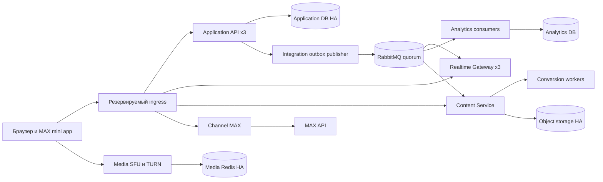

# Службы и потоки данных

Статус: целевое устройство, ещё не реализация. Развёртывание одной установки,
один набор пользователей/курсов/ботов учреждения, один публичный origin.

## Границы служб

| Служба | Владеет | Развёртывание и отказ |
|---|---|---|
| Application API | IAM, организация, курсы, лекции, состояния занятий, участники, вопросы, проверки и сигналы; idempotency и integration outbox | 3 реплики после удаления единственного process-local состояния; БД определяет результат команд |
| Realtime Gateway | SSE/WS-соединения, краткоживущие разрешения, cursor, bounded fanout и room cache | 3 реплики; потеря процесса вызывает reconnect, не потерю занятия |
| Content Service + workers | Загрузка, версии материалов, import jobs, метаданные объектов и безопасная конвертация | API и workers имеют разные бюджеты; падение LibreOffice не влияет на занятие |
| Analytics Service | Подготовленные итоги и проекции, inbox consumers, экспорт и версии расчётов | 2 consumers; запаздывание видно пользователю, команды занятия от отчёта не зависят |
| Channel Service / MAX adapter | Webhook dedupe, provider jobs, ACK/leases, rate limits/cooldown и DLQ | 2 workers с общей очередью; потеря MAX не останавливает веб-канал |
| Media SFU + TURN | WebRTC signalling и медиапакеты; распределение комнат | Независимый пул узлов, свой Redis; видео не проксируется Application API |

Не выделять IAM, голос, светофор, QA и каждый CRUD в отдельные сетевые службы на
первом этапе. Особенно важно сохранить одну транзакцию «закрыть занятие, закрыть
проверку, сохранить принятые ответы, записать событие». Отдельные сервисы должны
давать независимые выпуск/масштаб/отказ, а не только новые HTTP-клиенты.

Application API остаётся модульным внутри своей границы. Это сервисная архитектура
с крупными предметными границами; количество сервисов не является критерием качества.
Выделение учебного домена в ещё один service возможно позже при отдельной причине.

Диаграмма показывает границы, а не все проверки прав и обратные вызовы. Полные
правила приватности и межсервисных запросов: [контракты](contracts.md).

## Владение данными

Application, Content, Analytics и Channel получают собственные базы/роли и
миграции. На первом промышленном этапе это могут быть логические БД одного
PostgreSQL HA-кластера; это общий отказный и ресурсный домен, не независимые кластеры.
Другой сервис не пишет в чужую БД и не делает межбазовые JOIN.

Application хранит `deckVersionId`, опубликованный manifest и исторический снимок
лекции, но не управляет файлами converter. Content получает ограниченное внутреннее
разрешение на конкретный курс/операцию; identity-проверка не переносится в worker.
Готовая immutable версия публикуется один раз. Удаление материала учитывает ссылки
из исторических занятий; orphan cleanup имеет задержку и сверку ссылок.

Отчёты читаются из Analytics DB после проверки доступа через Application API.
UI видит `asOfVersion`, время расчёта и состояние «готовится», если проекция отстаёт.
Текущие SQL-агрегаты внутри Application сохраняются до сверки новой проекции.

## Realtime

1. Бизнес-команда приходит HTTP в Application API, проверяет актуальные права,
   транзакционно меняет состояние и пишет outbox. Ответ содержит результат и версию.
2. Publisher подтверждает отправку RabbitMQ; при потере ответа повторяет тот же
   `eventId`. Вызов брокера не входит в открытую бизнес-транзакцию.
3. Gateway получает инвалидацию/проекцию, объединяет обновления одного занятия
   и отправляет только подписанным локальным соединениям.
4. Общая часть собирается на занятие/версию. Собственные ответы, вопросы и
   ограничения участника идут отдельным персональным overlay.
5. При reconnect клиент может попасть в любую реплику. Gateway заново проверяет
   разрешение и cursor; при неизвестном cursor запрашивает полный актуальный снимок.

Не отправлять студентам всю историю вопросов каждую секунду. Не читать БД по
каждому keepalive. Keepalive проверяет транспорт, а подтверждение присутствия
остаётся отдельным ограниченным по частоте действием клиента.

Сохранить текущие клиентские SSE/HTTP и WS-контракты на первом этапе извлечения.
Первый gateway может переиспользовать Spring async transport; смена на Netty не
является необходимым условием выделения. Выбор окончательного transport runtime
подтверждается отдельным тестом 6 000 соединений на реплику после отказа соседа,
включая запас к студентам на окна ведущих и проекторы.

Для fanout нужна отдельная transient subscription queue каждой живой реплики,
а не одна общая competing-consumer queue. Она не должна копить старые кадры при
выключенном gateway. Потеря уведомления восстанавливается из authoritative snapshot;
для Analytics/Content/Channel используются другие, durable quorum queues.

## Чтения и записи

- Долгие соединения не занимают JDBC connection. Gateway не получает доступ к БД.
- Изображения слайдов и исходники раздаются object storage/cache по immutable key;
  авторизация проверяется до выдачи короткоживущей ссылки. TTL ссылки ограничивает
  окно отзыва; уже загруженный файл отозвать нельзя.
- API читает только нужный слайд/страницу, сохраняет лимиты кэшей и пагинацию.
- У команды есть deadline и очередь admission, у импорта/аналитики свои bulkheads.
- Голоса и сигналы сохраняются с естественным уникальным ключом. Объединять можно
  публикацию агрегата, но нельзя отвечать «голос принят» до durable commit.
- Не брать одну строку `live.sessions FOR UPDATE` на каждый голос/heartbeat.
  Для редких управляющих команд блокировка занятия уместна. Текущий lock отправки
  вопросов и модерации отдельно нагрузочно проверить; при изменении сохранить
  гарантию запрета вопроса после завершившегося mute.

## Media

Предлагаемый SFU: self-hosted LiveKit. Gateway/Application выдают ограниченный
room token: студент может только подписываться, ведущий публикует только в своё
занятие. Исходный MediaStream у ведущего отправляется в SFU; SFU раздаёт зрителям,
TURN обеспечивает путь через ограниченные сети. Серверный токен не попадает в UI.

LiveKit распределяет комнаты между узлами через Redis, но одна комната должна
поместиться на одном SFU-узле. Плановые остановки используют draining. Это
ограничение продукта SFU, а не возможность бесшовно переносить любую большую
лекцию между узлами. [Официальное описание](https://docs.livekit.io/transport/self-hosting/distributed/).

JPEG/H.264 fallback текущего core не масштабируется как бесконечная замена SFU.
При аварии предпочтителен обычный слайд или ограниченное обновление последнего
кадра через storage; частота/размер и число fallback-получателей имеют бюджет.
Один отказ SFU не должен создавать 10 000 интенсивных media polling циклов в API.
Особенности кодеков, разрешения, читаемости кода, MAX/iOS и TURN проверяются отдельно.

## Инфраструктура

Публичный origin завершается на резервируемом L4/L7 входе: managed HA load balancer
площадки либо проверенная пара ingress/VIP на независимых узлах. Один Caddy/Tuna
на одном Mac не входит в production HA-топологию. Проверить отказ самого входного
узла, маршрутизатора и uplink; DNS-запись сама по себе эти точки не резервирует.

HTTPS/SSE/WS используют 443, а WebRTC и TURN имеют отдельные UDP/TCP/TLS маршруты
и media hostname. Регистрация доменов, CORS и доступность из MAX/кампусной сети
проверяются на выбранной площадке: открывшийся сайт не доказывает доступность
UDP или TURN. TLS/cert rotation и доступ к служебным портам принадлежат оператору.

PostgreSQL HA, RabbitMQ quorum и media Redis размещаются в разных процессах с
раздельными ресурсами и дисками. Redis не хранит единственную копию голосов или
пользовательских данных. Для его отказа предусмотрено восстановление служебного
состояния; подтверждённые команды остаются в PostgreSQL.

Для production reference предполагается Linux-площадка с оркестрацией, anti-affinity,
readiness/draining и несколькими независимыми узлами. Можно использовать существующий
кластер учреждения. Локальный Compose остаётся компактным dev-профилем; набор
production-манифестов нельзя считать готовым до выбора площадки и fault tests.
